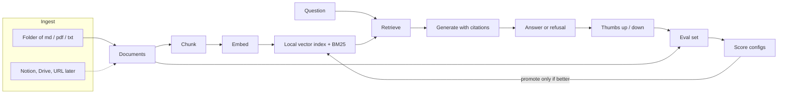

# AutoRAG

AutoRAG turns a folder of documents into a question-answering API that cites its sources, then **tunes itself**. You point it at a handbook. It cuts the pages into passages, searches them, answers with a quote and a citation, grades itself against known questions, and keeps a new setup only when the score actually goes up.

The worked example is **Acme Co**, a fictional company of about 420 people. The questions are the ones a new hire would ask:

- How many PTO days after 3 years?
- What's the client dinner expense limit?
- How do I request parental leave?

An older 2023 PTO policy is still in the folder and disagrees with the 2025 one. A Slack export repeats the old number. The tuner has to prefer the current page.

## What “RAG” means here

A language model does not have your handbook in its head. Retrieval-augmented generation (RAG) does this instead:

1. **Find** the few passages that might contain the answer.
2. **Answer** using only those passages, and show them.
3. **Refuse** when the passages do not cover the question.

The hard part is step 1. Cut the pages too small and a table loses its column headers. Cut them too big and the search returns a whole chapter. Return the old policy and the answer is confidently wrong. AutoRAG searches those choices and measures them.

## Architecture



Each box is a module under `autorag/`.

| Stage | Module | In plain language | In the code |
| --- | --- | --- | --- |
| Ingest | `pipeline/ingest.py` | Read the files and keep a title, a date, and whether the page is current. | `LocalFolderLoader` for Markdown, text, and PDF. `NotionLoader` and `GoogleDriveLoader` share the same `load()` shape and raise a clear error until a client is plugged in. `UrlLoader` fetches a page. |
| Chunk | `pipeline/chunk.py` | Cut each document into pieces the search can handle. | `fixed` is a word window and will slice through a table. `structure` splits on headings and keeps each markdown table in one piece, header included. |
| Embed | `pipeline/embed.py` | Turn text into a list of numbers so “PTO” and “paid time off” can match. | Default is `sentence-transformers/all-MiniLM-L6-v2` on CPU. Set `OPENAI_API_KEY` to use OpenAI embeddings. Tests use a hashing embedder so they need no download. |
| Index | `pipeline/index.py` | Store those numbers and find the nearest ones. | In-process numpy index, saved as `vectors.npy`. Optional Chroma backend: `pip install 'autorag[chroma]'` and `AUTORAG_INDEX=chroma`. |
| Retrieve | `pipeline/retrieve.py` | Pick a handful of passages. | Vector search, optional BM25 (keyword search) mixed in with reciprocal rank fusion, an optional reranker, and a penalty for superseded or unofficial pages. |
| Generate | `pipeline/generate.py` | Write the answer from those passages only. | Default is extractive: it quotes the matching sentence or table row, so it cannot invent a number. Ollama or OpenAI will write the sentence instead when you ask them to. |
| Eval | `eval/` | Grade the answer. | Gold questions in JSONL, or synthetic questions when you have none. |
| Tune | `tune/loop.py` | Try several setups. Keep one only if it scores higher. | History in `runs/autorag.sqlite` and `data/acme/tune_results.json`. |

## Acme handbook

`scripts/generate_dataset.py` is the source of truth. It writes the markdown and the questions from the same sentences, so a number in the eval set is the number in the policy. The generated files are committed, so the repo works offline.

```bash
python scripts/generate_dataset.py
```

The folder `data/acme/docs/` has 51 pages: PTO, sick leave, parental leave, holidays, remote work, benefits tables, expense limits, per diem by city, laptops, VPN, a first-week checklist, offices, and contacts. Deliberate mess:

- `hr/pto-policy-2023.md` is **superseded** and still says 16 PTO days after 3 years. The 2025 policy says 22.
- `exports/slack-ask-hr.md` and `exports/slack-ask-it.md` are unofficial Slack dumps. People in them repeat the old numbers and a retired VPN hostname.
- Pocket-card and “IT copy” pages are **duplicates** of the canonical policy.

`data/acme/eval.jsonl` has **623** graded questions: factual, table lookups, multi-document, conflicting versions, and questions the handbook cannot answer (pet insurance, the CEO’s home address). Those last ones should be refused.

## Quickstart

Python 3.11+. The first run downloads the MiniLM embedding model (about 90 MB). No API key.

```bash
python -m pip install -e ".[dev]"
python -m pytest
python -m autorag tune --source data/acme
python -m autorag serve --source data/acme --host 0.0.0.0 --port 8091
```

Or: `make install`, `make test`, `make tune`, `make serve`.

Open [http://127.0.0.1:8091](http://127.0.0.1:8091). The page has suggested questions, a free-text box, citations, helpful / not helpful, a comparison against the untuned baseline, and the tuning chart.

Docker, same port:

```bash
docker compose up --build
```

The image installs CPU PyTorch so it does not pull the CUDA wheel. `docker compose --profile ollama up` also starts [Ollama](https://ollama.com). Set `AUTORAG_GENERATOR=ollama` and `OLLAMA_MODEL` when you want a local chat model to write the replies. Without that, answers are quotations from the handbook.

Useful commands:

```bash
python -m autorag ask "How many PTO days after 3 years?" --source data/acme
python -m autorag ask "How many PTO days after 3 years?" --variant baseline
python -m autorag eval --source data/acme
python -m autorag synth --source ./our-docs --out ./our-docs/eval.synthetic.jsonl
python -m autorag synth --source ./our-docs --out ./our-docs/eval.llm.jsonl --llm
```

`--llm` asks OpenAI or a running Ollama to write the questions. With neither available, the heuristic writer turns concrete sentences into questions and says so.

## Point it at your own documents

Put Markdown, text, or PDF files in a folder. A YAML front matter block is optional and useful:

```yaml
---
id: travel-policy
title: Travel Policy
status: current          # current | superseded | unofficial | duplicate
effective_date: 2025-01-01
department: Finance
---
```

Then:

```bash
python -m autorag tune --source ~/Documents/handbook
python -m autorag serve --source ~/Documents/handbook --port 8091
```

If `eval.jsonl` is missing, `tune` writes a synthetic set next to the files and scores against that. Read it before you trust the score. A synthetic question only checks “can we quote this passage back,” which is a start, not a substitute for questions a person actually asks.

Copy `.env.example` to `.env` if you add a paid model. Nothing in the repo reads a key that you did not set.

| Variable | Role |
| --- | --- |
| `OPENAI_API_KEY` | Chat and embeddings, when the generator or embedder is `openai`. |
| `OPENAI_MODEL` | Default `gpt-4o-mini`. |
| `OLLAMA_HOST` | Default `http://127.0.0.1:11434`. |
| `OLLAMA_MODEL` | Default `llama3.2`. |
| `AUTORAG_GENERATOR` | `extractive` (default here), `ollama`, `openai`, or `auto`. |
| `AUTORAG_INDEX` | `local` (default) or `chroma`. |

`auto` uses OpenAI if a key is set, otherwise Ollama if it answers on `/api/tags`, otherwise the extractive quoter.

## How tuning decides

`autorag tune` runs seven configs. The first is a weak baseline: 80-word windows, two passages, vector search only, no preference for current documents. Later configs turn on structure-aware chunks, keyword search, a lexical reranker, a larger window, or a higher `top_k`.

Every question is scored. The composite is:

| Piece | Weight | What it measures |
| --- | --- | --- |
| Answer correctness | 0.34 | For a graded question, a mix of “the reply contains the gold wording” (token recall, weight 0.38) and “the reply contains the gold numbers and not a pile of other numbers” (number F1, weight 0.62). Unanswerable questions score 1 only on a refusal. A thumbs-down with no correction scores 1 when the pipeline stops repeating the rejected answer. |
| Faithfulness | 0.10 | Share of the answer’s content words that appear in the retrieved passages. A refusal adds no claim, so it scores 1. |
| Context recall | 0.18 | Fraction of the gold source documents that showed up in the retrieved set. |
| Context precision | 0.08 | Fraction of retrieved documents that were actually on the gold list. |
| Hit rate | 0.15 | Fraction of answerable questions with at least one gold document retrieved. |
| MRR | 0.15 | How high the first gold document was ranked. |

These are the same *ideas* as [Ragas](https://docs.ragas.io) (faithfulness, answer correctness, context precision, context recall), computed locally from the text. Ragas normally asks a second model to judge. This project does not, because the loop has to finish with no API key. The numbers below are from that local scorer, on all 623 Acme questions, with `sentence-transformers/all-MiniLM-L6-v2` and the extractive generator.

A config is **promoted** only when its composite is strictly higher than the best so far. Tied and worse runs are stored and not served.

Feedback (`POST /feedback`, or the buttons on the demo) is stored in `runs/autorag.sqlite`. The next `autorag tune` folds it in:

- Thumbs up becomes a graded question whose answer is the one the person liked.
- Thumbs down with a correction becomes a graded question using the correction.
- Thumbs down without a correction counts as a miss if the pipeline repeats that answer.

Optional: `autorag tune --source data/acme --finetune` fine-tunes MiniLM on (question, gold passage) pairs with in-batch negatives and scores that model as one more config. It is off by default. It needs the gold set.

Schedule a re-run with GitHub Actions (`.github/workflows/autorag.yml` runs tests on every push and tunes on Monday at 06:15 UTC) or cron:

```cron
15 6 * * 1  cd /opt/autorag && python -m autorag tune --source data/acme >> /var/log/autorag-tune.log 2>&1
```

## Results from the Acme tune

Run locally with the free embedding model and the extractive generator. 51 documents, 623 questions, seven configs. Source file: `data/acme/tune_results.json`.

| Config | Chunks | k | Hybrid | Rerank | Prefer current | Composite | Correct | Faithful | Recall | Precision | Hit rate | MRR | Kept |
| --- | --- | ---: | --- | --- | --- | ---: | ---: | ---: | ---: | ---: | ---: | ---: | --- |
| baseline | fixed 80 | 2 | no | no | no | 0.9018 | 0.8727 | 1.0000 | 0.9732 | 0.5588 | 0.9740 | 0.9273 | yes, first |
| recency | fixed 80 | 4 | no | no | yes | 0.8997 | 0.8905 | 1.0000 | 0.9965 | 0.3012 | 0.9965 | 0.9598 | no |
| structure | structure 360/60 | 5 | no | no | yes | 0.9467 | 0.9901 | 1.0000 | 1.0000 | 0.3897 | 1.0000 | 0.9926 | yes |
| **hybrid** | structure 360/60 | 5 | yes | no | yes | **0.9474** | **0.9927** | 1.0000 | 1.0000 | 0.3818 | 1.0000 | 0.9957 | **yes, best** |
| rerank | structure 360/60 | 5 | yes | lexical | yes | 0.9470 | 0.9895 | 1.0000 | 1.0000 | 0.3840 | 1.0000 | 0.9991 | no |
| wider-chunks | structure 520/80 | 5 | yes | lexical | yes | 0.9470 | 0.9895 | 1.0000 | 1.0000 | 0.3840 | 1.0000 | 0.9991 | no |
| high-k | structure 360/60 | 8 | yes | lexical | yes | 0.9339 | 0.9895 | 1.0000 | 1.0000 | 0.2196 | 1.0000 | 0.9991 | no |

Composite moved from **0.9018** to **0.9474** (+0.0456). Where it moved, by question type (correctness):

| Type | n | Baseline | Best |
| --- | ---: | ---: | ---: |
| Conflicting versions | 37 | 0.5462 | 1.0000 |
| Table lookup | 38 | 0.2822 | 0.9765 |
| Factual | 490 | 0.9358 | 1.0000 |
| Multi-document | 13 | 0.7084 | 0.7190 |
| Should be refused | 45 | 1.0000 | 1.0000 |

Faithfulness stayed at 1.0 because the extractive generator only emits words that were in the passage. The gains are retrieval and chunking:

- The baseline quoted the wrong tenure band for “PTO after 3 years” (it said 25 days, the 5-year line). The promoted config quotes the 2025 sentence: 22 days.
- Table questions jumped because a fixed word window flattens a markdown table and the row is no longer attached to its header. The structure chunker keeps the table whole, and the answer becomes one row: Chicago lodging per diem is $220.
- Pulling more passages (`high-k`) kept the right document in the set but dragged context precision down to 0.2196, so that config was not promoted. Preferring current documents without fixing the chunks (`recency`) also lost on precision and was not promoted.

## API

| Method | Path | Body / response |
| --- | --- | --- |
| `GET` | `/health` | `loading` until the index is built, then document count and the active config. |
| `POST` | `/ask` | `{ "question": "...", "variant": "best" \| "baseline" }` → answer, citations (title, snippet, status, date), confidence, `refused`. |
| `POST` | `/feedback` | `{ "question", "answer", "rating": "up" \| "down", "correction?", "doc_ids" }`. |
| `GET` | `/suggested-questions` | Chips for the demo. From `suggested.json` when the corpus has one. |
| `GET` | `/runs` | Every tuning run, the baseline, the promoted config, and the composite delta. |
| `GET` | `/` | The handbook page. |

Confidence is how much of the question’s wording is covered by the quoted passage. It is not a probability from a model.

## Tests

```bash
python -m pytest
```

The tests cover ingest (markdown, text, PDF, a mocked URL, and the Notion/Drive stubs), both chunkers, retrieval with the hashing embedder, refusal, the metric math, a two-config tune that must beat its baseline, synthetic questions, feedback storage, fine-tune pair building, and the HTTP API. They do not download a model. `tests/test_acme_dataset.py` checks that the committed handbook still has 50+ files, the conflicting PTO policies, the Slack export, and that every graded answer is actually in its source document.

## Layout

```
autorag/            pipeline, eval, tuning, FastAPI, demo page
data/acme/          generated handbook, eval.jsonl, tune_results.json
scripts/            generate_dataset.py
tests/              stage tests and the Acme corpus checks
runs/               sqlite history, feedback, latest.json (gitignored)
```

## License

MIT.
