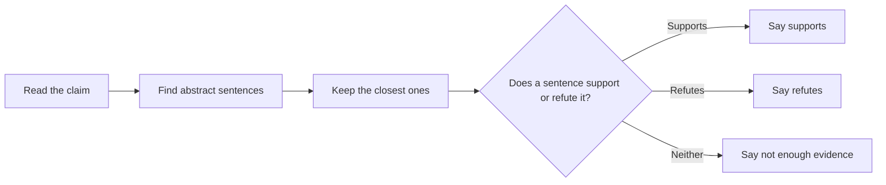
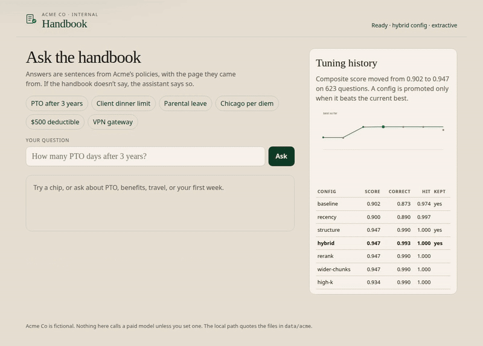
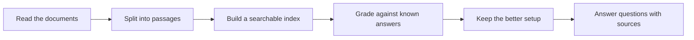
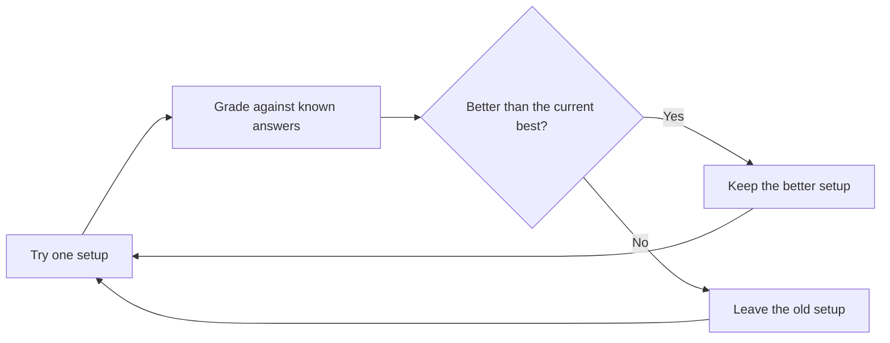
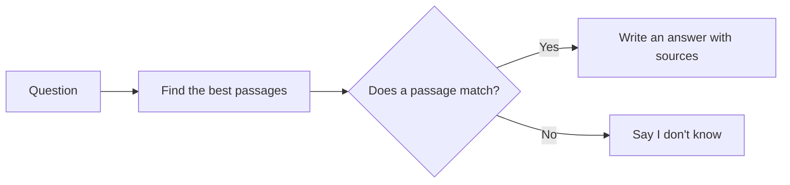

# AutoRAG

Check a claim against the documents, then keep a setup only when it still works on questions it did not tune on.
The same commands point at a folder of scientific abstracts or at any other collection.

**[Live demo](https://autorag-handbook.onrender.com)**

The free host sleeps when idle, so the first load can take about a minute.

## Checking claims against scientific evidence

The headline task is SciFact: 1,409 expert-written claims and 5,183 PubMed abstracts from Allen AI, labelled supports, refutes, or not enough evidence, with the sentences that justify the label. The raw files are not in git. `make data-scifact` downloads the [official release](https://scifact.s3-us-west-2.amazonaws.com/release/latest/data.tar.gz). The dataset is [CC BY-NC 2.0](https://creativecommons.org/licenses/by-nc/2.0/). Cite Wadden et al., Fact or Fiction: Verifying Scientific Claims, EMNLP 2020. Details and the BibTeX are in [examples/scifact/README.md](examples/scifact/README.md).

```bash
make data-scifact
autorag tune-claims --source examples/scifact
autorag check-claim "Your claim here." --source examples/scifact
```

`POST /check-claim` takes `{"claim": "..."}` and returns a verdict (`supports`, `refutes`, or `not-enough-evidence`), a confidence, and the top evidence sentences with their document ids. Tuning searches retrieval setups on the 809 train claims only. The 300 dev claims are scored once, after the winner is frozen. The hidden test labels are never loaded.

The verdict step is the public NLI model `cross-encoder/nli-deberta-v3-small` on CPU, with no API key. That model plus PyTorch does not fit the 512 MB free host. There, `AUTORAG_RUNTIME=lite` still serves `/check-claim`, using an extractive verdict (shared words and a negation check) instead of NLI. The numbers below are the NLI run, from `examples/scifact/results.json`.

The baseline retrieves with BM25 and then always says **supports**, because that was the most common train label (332 of 809). On the 300 dev claims that is right **0.4133** of the time, and it scores **0** on the other two labels, so macro-F1 is **0.1950**. The tuned setup is hybrid search (sentence chunks, keyword search mixed with vectors, then a lexical reorder) plus the NLI model. The cuts, chosen only on train, are 0.45 to say supports and 0.65 to say refutes. On dev it is right **0.4667** of the time. Macro-F1 is **0.4676**, because it uses all three labels. It is careful about supports (precision **0.7963**, recall **0.3468**) and more willing to say refutes (precision **0.3381**, recall **0.7344**). Not-enough-evidence lands in the middle (precision **0.4673**, recall **0.4464**).

Of the dev claims that have gold evidence (188 of 300), the tuned setup finds **0.8269** of the gold abstracts in its top 5 sentences, against **0.7420** for BM25. It finds **0.5429** of the expert rationale sentences, against **0.4117**. A dev claim takes **0.1964** seconds on average once the models are loaded (baseline **0.0748**). Two other NLI setups were tried on train only. BM25 plus NLI scored macro-F1 0.4305. Taking 8 sentences instead of 5 scored 0.4560. Hybrid with 5 sentences scored 0.4788 and was kept. Dev was not used for that choice.

| | Baseline | Tuned |
| --- | ---: | ---: |
| Verdict | always supports | hybrid search + NLI |
| Accuracy | 0.4133 | 0.4667 |
| Macro-F1 | 0.1950 | 0.4676 |
| Abstract recall@5 | 0.7420 | 0.8269 |
| Sentence recall@5 | 0.4117 | 0.5429 |
| Seconds per claim | 0.0748 | 0.1964 |

| Dev label | How many | Precision | Recall | F1 |
| --- | ---: | ---: | ---: | ---: |
| supports | 124 | 0.7963 | 0.3468 | 0.4831 |
| refutes | 64 | 0.3381 | 0.7344 | 0.4631 |
| not enough evidence | 112 | 0.4673 | 0.4464 | 0.4566 |



A claim is checked by finding sentences in the abstracts, then deciding whether those sentences support it, refute it, or are not enough.

## The handbook, as a second folder

Point it at any company's documents.
It builds a question-answering API that cites the page each answer came from.
It tests and tunes itself until the answers are measurably right.

Acme Co is the demo, not the product. Before tuning, "How many PTO days after 3 years?" quoted the five-year line from the 2025 policy: **25 days**. After tuning, it quotes the three-year line from that same policy: **22 days**.




Asking a suggested question and comparing the untuned vs tuned answer

## Swap in another folder

Two commands. No code changes. The folder can be any mix of Markdown, text, and PDF.

```bash
autorag tune --source examples/harbor-kitchen
autorag serve --source examples/harbor-kitchen
```

`examples/harbor-kitchen` is a 9-page restaurant FAQ. One command wrote the test questions from the pages (`eval.jsonl`, 12 questions). The tune then scored seven setups. The plain starting setup already scored **0.96**. Nothing else beat it, so that starting setup stayed. Asking "How much is the harbor burger?" returns the current menu price, **$16**, not the retired 2023 price of $12.

The same two commands work for the Acme handbook, or for a folder of your own:

```bash
autorag tune --source data/acme
autorag serve --source data/acme
```

`autorag.yaml` is only a default for when you leave `--source` off. It currently says `source: data/acme`. Change that one line if you want `autorag tune` and `autorag serve` to use a different folder.

## Words, then the Acme scores

A **chunk** is one passage cut from a longer document. An **embedding** is a list of numbers for a passage or a question, so two texts about the same thing land near each other even when the words differ. **Vector search** finds the nearest numbers. **Keyword search** (BM25) finds passages that share rare exact words. A **reranker** reorders that short list before an answer is written. An **eval set** is the list of test questions with known answers. A **composite score** is one number that mixes how right the answer was, whether its words came from the pages, and whether the right page was found. Higher is better. A setup is kept only when this number goes up.

These numbers are from `data/acme/tune_results.json` (51 documents, 623 questions). The tuner sees 498 of them. The table is the other 125, which are not used to choose a winner. An older run that scored the same questions it tuned on went from 0.8968 to 0.9435. This held-out run goes from **0.8887** to **0.9405**. Hybrid is still the one that was kept: on the 498 it scored 0.9442, just ahead of structure at 0.9422. On the 125 it did not see, structure is 0.9412 and hybrid is 0.9405. The kept setup is the one chosen before those 125 were opened. The Score column is that held-out composite.

| Setup | What changed | Score | Right answers | Kept |
| --- | --- | ---: | ---: | --- |
| baseline | Short hard cuts, 2 passages, vector search only | 0.8887 | 0.8504 | yes, the start |
| recency | Same cuts, but old pages count less | 0.8951 | 0.8779 | no |
| structure | Keep headings and tables in one piece | 0.9412 | 0.9727 | yes, then hybrid beat it on the tune split |
| **hybrid** | Also mix in keyword search | **0.9405** | **0.9727** | **yes, kept** |
| rerank | Then reorder the short list by the question's words | 0.9380 | 0.9647 | no |
| wider-chunks | Bigger pieces | 0.9380 | 0.9647 | no |
| high-k | Hand back 8 passages instead of 5 | 0.9244 | 0.9647 | no |

**Conflict questions** are old-versus-new policy disagreements. The full set has 37 of them; 7 landed in the held-out 125. On those 7, the starting setup got **0.3000** right and the kept setup got **1.0000**. Table questions in the held-out slice (8 of them) went from **0.3687** to **0.8882**. Ordinary facts (98) went from **0.9263** to **0.9898**. Questions that need more than one page (3) stayed at **0.4921**. Questions the files cannot answer were refused every time (**1.0000**, 9 questions). The conflict, table, and multi counts are small, so those four rates move more than the composite does.

- **Right answers** (correctness): the reply contains the known answer, including the right numbers. Saying "I don't know" scores full marks only when the files really don't say.
- **Faithfulness**: the reply's words appear in the passages that were found. It is **1.0 on every setup** because the default writer quotes a sentence instead of paraphrasing. A faithful quote can still be the wrong sentence. Correctness is what catches that.
- **Recall** (context recall): of the pages that hold the answer, how many were found.
- **Precision** (context precision): of the pages that were found, how many actually hold the answer. Fetching 8 passages found every right page in the held-out slice and dropped precision to 0.2138, so that setup was not kept.
- **Hit rate**: at least one of the right pages was in the pile. 1.0 means every answerable question found a right page.
- **MRR** (mean reciprocal rank): how close to the top the first right page sat. 1.0 means it was the first page every time.

## How it fits together



Documents go in, the better setup is kept, and a question-answering API is what you run.



A setup replaces the current one only when the known questions score higher.



The answer quotes a passage and names the page, or it says the files do not cover it.

## Quickstart

```bash
docker compose up --build
```

Open [http://127.0.0.1:8091](http://127.0.0.1:8091). The container does not install PyTorch. It loads a saved index and only turns the question into numbers.

Without Docker:

```bash
python3 -m pip install -e ".[dev,lite]"
make test
AUTORAG_RUNTIME=lite python3 -m autorag serve --host 0.0.0.0 --port 8091
```

Re-running the measured Acme tune needs the PyTorch extra, which is too big for a 512 MB free host:

```bash
python3 -m pip install -e ".[dev,local]"
make tune
```

OpenAI and Ollama are optional. Set `generator: openai` or `generator: ollama` in `autorag.yaml`, or set `AUTORAG_GENERATOR`. With neither, answers are quotes from the files. Copy `.env.example` only if you add a key. The repo has no secrets.

## Deploy

The [live demo](https://autorag-handbook.onrender.com) is hosted on Render's free plan. The service is defined in [render.yaml](render.yaml), and pushes to `main` deploy it. That image is the handbook, not the SciFact corpus. `POST /check-claim` works there with the extractive verdict, because the NLI model does not fit in 512 MB.

## Free hosting

The Dockerfile is the same image for a laptop, Render, and Hugging Face Spaces. It fits a 512 MB instance. Passage numbers are already saved under `data/acme/index/`. Thumbs and new tune runs live on the instance disk and disappear on restart.

**Render.** [render.yaml](render.yaml) is a free web service (`plan: free`, 0.1 CPU, 512 MB). Sync the Blueprint from the Dashboard. Render sets `PORT`. Free instances sleep after about 15 minutes without a request.

**Hugging Face Spaces.** Create a Docker Space from this repo. The block at the top of this file sets the port to 7860. No key is required.

## Honesty

Acme Co is synthetic. The 623 gold questions were generated from the same sentences as the pages, then checked so each question still selects that sentence. The scores above are the held-out 125, not the 498 the tuner saw. Faithfulness is 1.0 because the default generator quotes rather than paraphrases. Harbor Kitchen's 12 questions were generated the same way, which is why the simple setup already scored 0.96 and was kept. SciFact is the real set: expert claims, real abstracts, and a dev split the tuner never saw.

## Tests

```bash
make test
```

Each stage has its own file. One test runs the Harbor Kitchen folder through tune and ask. They do not need a network. The ONNX check is skipped if fastembed is not installed.

## Layout

```
autorag.yaml          default folder, title, and optional generator
autorag/              the pipeline, the API, and the demo page
data/acme/            the handbook demo, its questions, and its saved index
examples/scifact/     SciFact claim checker, license, and dev-split scores
examples/harbor-kitchen/   a second folder, to prove the swap
docs/                 screenshot and short recording
```

## License

MIT.
