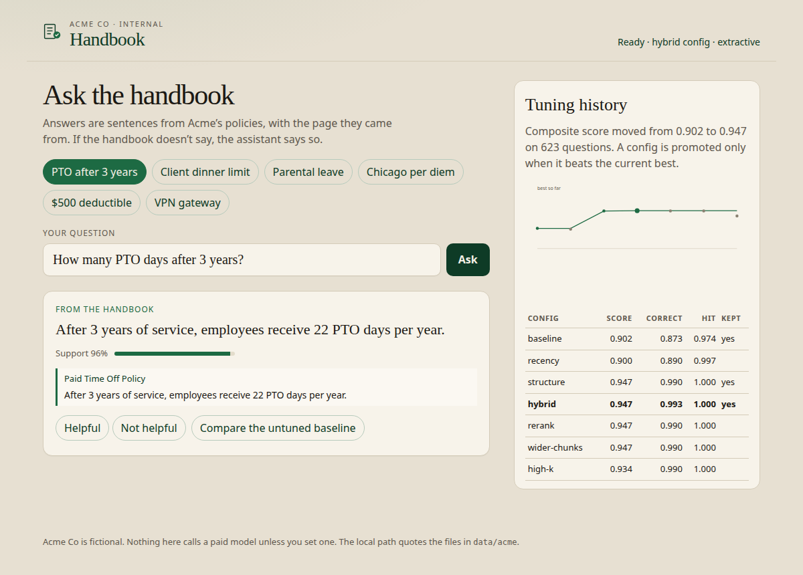
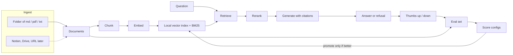

# AutoRAG

AutoRAG reads a folder of company documents and answers questions by quoting the page the answer came from. It also tries several ways of cutting up and searching those pages, scores each way against questions it already knows the answer to, and keeps a new way only when the score goes up. The example is Acme, a made-up company, so you can ask ordinary things: how many vacation days you get after three years, what you can spend on a client dinner, and how to request parental leave.




## What this is

A language model does not have your handbook memorized. The usual fix is to search the handbook first and only then write an answer. That search is easy to get wrong: cut a page in the wrong place and a table loses its headers, or an old policy outranks the current one. AutoRAG is that search, plus a loop that measures whether a change helped.



## How it works

**Ingest.** Read the folder. Markdown, text, and PDF come in today. Each file can say whether it is current, out of date, a duplicate, or an unofficial dump like a Slack export. Notion, Google Drive, and a web page use the same “give me documents” shape. Drive and Notion stop with a clear message until someone plugs in a client. A single web page can be fetched now.

**Chunk.** Cut each document into pieces small enough to search. The blunt way is a window of words, which will slice through the middle of a table. The careful way splits on headings, keeps a heading with its paragraphs, and keeps a whole table together so the column names stay attached to the numbers.

**Embed.** Turn each piece, and later each question, into a list of numbers so that “vacation” can land near “PTO” even when the words differ. The measured run used a small model called MiniLM, on your machine, with no API key. The demo container uses the same model in a smaller ONNX build so it does not need PyTorch.

**Index.** Store those numbers and, alongside them, a keyword index. Looking up a question is then “which stored pieces are closest?” The default store is a file of numbers in the repo. Chroma is optional if you want that instead.

**Retrieve.** Take the question’s numbers and return the closest pieces. Keyword search can be mixed in, which helps when the important part is a hostname or a dollar amount rather than a paraphrase. Pages marked superseded or unofficial can be pushed down so last year’s policy does not beat this year’s.

**Rerank.** Look again at that short list and reorder it. The built-in reranker prefers the passage that actually contains the words in the question. A heavier cross-encoder model is optional. On this handbook the heavier step did not beat the simpler mix, so it was not kept.

**Generate, with citations.** Write the answer from those passages only. The default copies the matching sentence or table row and names the page. If the passages do not cover the question, it says so instead of guessing. Ollama or OpenAI can write the sentence instead, using the same passages, when you turn them on.

**Evaluate.** Grade the answer against questions whose right answer and source pages are already known. Some of those questions are supposed to be refused. If a folder has no graded file, the tool writes starter questions from the documents. Those are a smoke test. Read them before you trust the score.

**Tune and promote.** Run the same questions through several setups: how the pages are cut, how many pieces come back, whether keyword search is on, whether old pages are penalized. Save every result. Replace the setup the API serves only when the new score is strictly higher.

**Feedback.** Thumbs up and thumbs down are stored. The next tune treats a thumbs-up as another graded question, a thumbs-down with a correction as the corrected answer, and a thumbs-down with no correction as a failure if the program repeats the rejected reply. Clicking the button does not re-tune by itself. Someone still runs the tune.

## Results

These numbers are copied from `data/acme/tune_results.json`. The run used the PyTorch MiniLM and the quoting generator, on 51 Acme documents and 623 questions. Nothing here is estimated.

| Config | Chunks | k | Hybrid | Rerank | Prefer current | Composite | Correct | Faithful | Recall | Precision | Hit rate | MRR | Kept |
| --- | --- | ---: | --- | --- | --- | ---: | ---: | ---: | ---: | ---: | ---: | ---: | --- |
| baseline | fixed 80 | 2 | no | no | no | 0.9018 | 0.8727 | 1.0000 | 0.9732 | 0.5588 | 0.9740 | 0.9273 | yes, first |
| recency | fixed 80 | 4 | no | no | yes | 0.8997 | 0.8905 | 1.0000 | 0.9965 | 0.3012 | 0.9965 | 0.9598 | no |
| structure | structure 360/60 | 5 | no | no | yes | 0.9467 | 0.9901 | 1.0000 | 1.0000 | 0.3897 | 1.0000 | 0.9926 | yes |
| **hybrid** | structure 360/60 | 5 | yes | no | yes | **0.9474** | **0.9927** | 1.0000 | 1.0000 | 0.3818 | 1.0000 | 0.9957 | **yes, best** |
| rerank | structure 360/60 | 5 | yes | lexical | yes | 0.9470 | 0.9895 | 1.0000 | 1.0000 | 0.3840 | 1.0000 | 0.9991 | no |
| wider-chunks | structure 520/80 | 5 | yes | lexical | yes | 0.9470 | 0.9895 | 1.0000 | 1.0000 | 0.3840 | 1.0000 | 0.9991 | no |
| high-k | structure 360/60 | 8 | yes | lexical | yes | 0.9339 | 0.9895 | 1.0000 | 1.0000 | 0.2196 | 1.0000 | 0.9991 | no |

Composite went from **0.9018** to **0.9474**. By question type, correctness moved like this:

| Type | Questions | Baseline | Best |
| --- | ---: | ---: | ---: |
| Old policy versus current policy | 37 | 0.5462 | 1.0000 |
| Table lookup | 38 | 0.2822 | 0.9765 |
| Ordinary fact | 490 | 0.9358 | 1.0000 |
| Needs more than one page | 13 | 0.7084 | 0.7190 |
| Should be refused | 45 | 1.0000 | 1.0000 |

What each column means:

- **Composite.** The single number used to decide whether a setup is kept. It is a weighted mix of the columns to its right.
- **Correct.** The reply contains the known answer, including the right numbers. A refusal scores 1 only when the question is not in the handbook.
- **Faithful.** The reply’s words appear in the passages that were retrieved. Quoting the passage makes this 1 even when the quote is the wrong sentence.
- **Recall.** Of the pages that hold the answer, how many showed up in the retrieved set.
- **Precision.** Of the pages that were retrieved, how many were actually pages that hold the answer.
- **Hit rate.** At least one of the right pages was in the set.
- **MRR.** How high the first right page was ranked. 1 means it was on top.

The baseline’s quote for “PTO after 3 years” is the five-year line, 25 days. The kept setup quotes the 2025 line, 22 days. Pulling eight passages instead of five (`high-k`) found every right page and dropped precision to 0.2196, so it was not kept.

A longer spoken version of these choices is in [INTERVIEW.md](INTERVIEW.md).

## Quickstart

One command, once Docker is installed:

```bash
docker compose up --build
```

Then open [http://127.0.0.1:8091](http://127.0.0.1:8091). The container does not install PyTorch. It loads the saved ONNX index under `data/acme/index/` and embeds only the question.

Without Docker:

```bash
python -m pip install -e ".[dev,lite]"
make test
AUTORAG_RUNTIME=lite python -m autorag serve --source data/acme --host 0.0.0.0 --port 8091
```

Tuning, which is what produced the table above, needs the PyTorch extra and is not part of the demo container:

```bash
python -m pip install -e ".[dev,local]"
make tune
make serve
```

`make test` runs the suite with no network and no PyTorch. `make up` is `docker compose up --build`.

```bash
python -m autorag ask "How many PTO days after 3 years?" --source data/acme
python -m autorag ask "How many PTO days after 3 years?" --variant baseline
```

## Point it at your own documents

Put Markdown, text, or PDF in a folder. This header is optional and useful:

```yaml
---
id: travel-policy
title: Travel Policy
status: current          # current | superseded | unofficial | duplicate
effective_date: 2025-01-01
department: Finance
---
```

```bash
python -m autorag tune --source ~/Documents/handbook
python -m autorag serve --source ~/Documents/handbook --port 8091
```

If `eval.jsonl` is missing, `tune` writes starter questions next to the files. Rebuild a free-host index after a tune with `python scripts/precompute_index.py` only for the Acme snapshot. For another corpus, leave `AUTORAG_RUNTIME` unset and use the `local` extra so the server embeds the passages itself.

Copy `.env.example` to `.env` only if you add a model you pay for. The repo does not contain a key.

| Variable | Role |
| --- | --- |
| `AUTORAG_RUNTIME` | `lite` loads the saved index and uses ONNX. Unset embeds with whatever provider the config names. |
| `AUTORAG_GENERATOR` | `extractive` quotes the page. `ollama`, `openai`, or `auto` write the sentence when that backend is actually available. |
| `OPENAI_API_KEY` | Only if you opt into OpenAI. |
| `OLLAMA_HOST` | Default `http://127.0.0.1:11434`. `docker compose --profile ollama up` starts it. |

## Run it on a free host

Both options use the same Dockerfile. It installs ONNX Runtime and fastembed, not PyTorch, and it is aimed at a 512 MB instance. Passage vectors are already in the image, so startup does not re-read the whole handbook through a model. The filesystem on these hosts is ephemeral: thumbs and new tune runs disappear on restart unless you add a disk. Do not put a real company’s private handbook on a public URL. There is no login.

**Render.** Free web service, plan `free` (0.1 CPU, 512 MB). [render.yaml](render.yaml) is the Blueprint. In the Render Dashboard, create a Blueprint and point it at this repo, or run `render blueprints validate` if you use the CLI. Render sets `PORT`. The service listens on `0.0.0.0:$PORT`. Free instances sleep after about 15 minutes of quiet. The first request after that waits for the process to wake.

**Hugging Face Spaces.** Create a Space, choose Docker, and point it at this repo. The block at the top of this README is the Space config: SDK `docker`, port `7860`. The image listens on 7860 unless `PORT` is set. No secret is required. The Space will rebuild from the Dockerfile the first time.

## Acme, and how the files are made

`scripts/generate_dataset.py` writes the handbook and the questions from the same sentences, then checks that each question still selects the sentence it claims. The generated files are committed so the repo works offline. `data/acme/docs/` has 51 pages. The 2023 PTO policy is marked superseded and still says 16 days after three years. Two Slack exports repeat stale numbers. A pocket card and an IT copy duplicate the canonical pages.

`data/acme/eval.jsonl` has 623 questions. `scripts/precompute_index.py` saves the ONNX vectors for the baseline and the winning setup.

## API

| Method | Path | What you get |
| --- | --- | --- |
| `GET` | `/health` | `loading` while the index opens, then `ok`. Always HTTP 200 while the process is up, so a free host does not restart it during startup. |
| `POST` | `/ask` | `{ "question", "variant": "best" or "baseline" }` → answer, citations, confidence, whether it refused. |
| `POST` | `/feedback` | `{ "question", "answer", "rating": "up" or "down", "correction?", "doc_ids" }`. |
| `GET` | `/suggested-questions` | The chips on the demo. |
| `GET` | `/runs` | The tune history. A fresh checkout shows the committed Acme run. |
| `GET` | `/` | The handbook page. |

Confidence is how much of the question’s wording is in the quoted passage. It is not a probability from a chat model.

A Monday re-tune, for a machine that has the PyTorch extra, is in `.github/workflows/autorag.yml`. Push checks (lint and tests, no PyTorch) are in `.github/workflows/ci.yml`. The same cron line works on a server:

```cron
15 6 * * 1  cd /opt/autorag && python -m autorag tune --source data/acme >> /var/log/autorag-tune.log 2>&1
```

## Tests

```bash
make test
```

Each stage has its own file: ingest, chunk, embed, index, retrieve, rerank, generate, evaluate, tune, feedback, and the HTTP endpoints including `/feedback`, `/suggested-questions`, and `/runs`. They use a hashing embedder, so they do not download a model. One test loads the committed ONNX index and checks the PTO answer. It is skipped if fastembed is not installed. `tests/test_acme_dataset.py` checks that the handbook on disk still matches the graded questions.

## Layout

```
autorag/                 pipeline, eval, tuning, API, demo page
data/acme/               handbook, questions, tune_results.json, saved ONNX index
docs/                    screenshot and GIF of the running page
scripts/                 generate the handbook, save the ONNX index
tests/                   one file per stage
render.yaml              Render free web service
Dockerfile               image used by Docker Compose, Render, and Spaces
```

## License

MIT.
