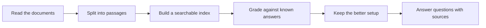
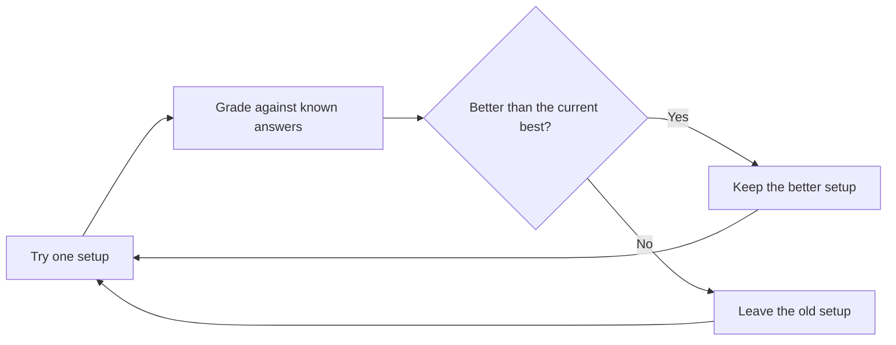
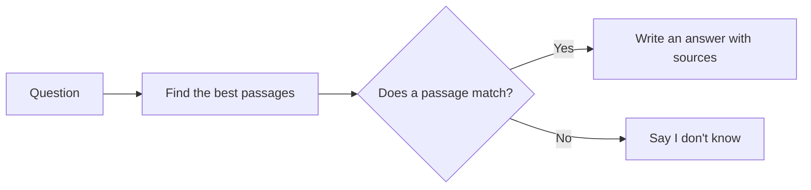

# AutoRAG

Point it at any company's documents.
It builds a question-answering API that cites the page each answer came from.
It tests and tunes itself until the answers are measurably right.

Acme Co is the demo, not the product. Before tuning, "How many PTO days after 3 years?" quoted the five-year line from the 2025 policy: **25 days**. After tuning, it quotes the three-year line from that same policy: **22 days**.


## Swap in another folder

Two commands. No code changes. The folder can be any mix of Markdown, text, and PDF.

```bash
autorag tune --source examples/harbor-kitchen
autorag serve --source examples/harbor-kitchen
```

`examples/harbor-kitchen` is a 9-page restaurant FAQ. One command wrote the test questions from the pages (`eval.jsonl`, 12 questions). The tune then scored seven setups. The plain starting setup already scored **0.96**. Nothing else beat it, so that starting setup stayed. Asking "How much is the harbor burger?" returns the current menu price, **$16**, not the retired 2023 price of $12.

The same two commands work for the Acme handbook, or for a folder of your own:

```bash
autorag tune --source data/acme
autorag serve --source data/acme
```

`autorag.yaml` is only a default for when you leave `--source` off. It currently says `source: data/acme`. Change that one line if you want `autorag tune` and `autorag serve` to use a different folder.

## Words, then the Acme scores

A **chunk** is one passage cut from a longer document. An **embedding** is a list of numbers for a passage or a question, so two texts about the same thing land near each other even when the words differ. **Vector search** finds the nearest numbers. **Keyword search** (BM25) finds passages that share rare exact words. A **reranker** reorders that short list before an answer is written. An **eval set** is the list of test questions with known answers. A **composite score** is one number that mixes how right the answer was, whether its words came from the pages, and whether the right page was found. Higher is better. A setup is kept only when this number goes up.

These numbers are from `data/acme/tune_results.json` (51 documents, 623 questions in the eval set). An earlier run, before "Acme" stopped being treated as a throwaway word, went from 0.9018 to 0.9474. This run goes from **0.8968** to **0.9435**. Same winner. The small drop is from that wording change, not from a new search idea. The Score column is the composite score.

| Setup | What changed | Score | Right answers | Kept |
| --- | --- | ---: | ---: | --- |
| baseline | Short hard cuts, 2 passages, vector search only | 0.8968 | 0.8580 | yes, the start |
| recency | Same cuts, but old pages count less | 0.8952 | 0.8774 | no |
| structure | Keep headings and tables in one piece | 0.9420 | 0.9762 | yes |
| **hybrid** | Also mix in keyword search | **0.9435** | **0.9801** | **yes, best** |
| rerank | Then reorder the short list by the question's words | 0.9427 | 0.9772 | no |
| wider-chunks | Bigger pieces | 0.9427 | 0.9772 | no |
| high-k | Hand back 8 passages instead of 5 | 0.9297 | 0.9772 | no |

**Conflict questions** are old-versus-new policy disagreements: the folder has an old page and a new page that disagree. There are 37 of them. The starting setup got **0.5482** of those right. The kept setup got **1.0000**. Table questions (a number that lives in a table) went from **0.2528** to **0.9710**. Ordinary facts went from **0.9227** to **0.9878**. Questions that need more than one page barely moved, **0.5814** to **0.5920**. Questions the files cannot answer were refused every time (**1.0000**).

- **Right answers** (correctness): the reply contains the known answer, including the right numbers. Saying "I don't know" scores full marks only when the files really don't say.
- **Faithfulness**: the reply's words appear in the passages that were found. It is **1.0 on every setup** because the default writer quotes a sentence instead of paraphrasing. A faithful quote can still be the wrong sentence. Correctness is what catches that.
- **Recall** (context recall): of the pages that hold the answer, how many were found.
- **Precision** (context precision): of the pages that were found, how many actually hold the answer. Fetching 8 passages found every right page and dropped precision to 0.2197, so that setup was not kept.
- **Hit rate**: at least one of the right pages was in the pile. 1.0 means every answerable question found a right page.
- **MRR** (mean reciprocal rank): how close to the top the first right page sat. 1.0 means it was the first page every time.

## How it fits together



Documents go in, the better setup is kept, and a question-answering API is what you run.



A setup replaces the current one only when the known questions score higher.



The answer quotes a passage and names the page, or it says the files do not cover it.

## Quickstart

```bash
docker compose up --build
```

Open [http://127.0.0.1:8091](http://127.0.0.1:8091). The container does not install PyTorch. It loads a saved index and only turns the question into numbers.

Without Docker:

```bash
python3 -m pip install -e ".[dev,lite]"
make test
AUTORAG_RUNTIME=lite python3 -m autorag serve --host 0.0.0.0 --port 8091
```

Re-running the measured Acme tune needs the PyTorch extra, which is too big for a 512 MB free host:

```bash
python3 -m pip install -e ".[dev,local]"
make tune
```

OpenAI and Ollama are optional. Set `generator: openai` or `generator: ollama` in `autorag.yaml`, or set `AUTORAG_GENERATOR`. With neither, answers are quotes from the files. Copy `.env.example` only if you add a key. The repo has no secrets.

## Free hosting

The Dockerfile is the same image for a laptop, Render, and Hugging Face Spaces. It fits a 512 MB instance. Passage numbers are already saved under `data/acme/index/`. Thumbs and new tune runs live on the instance disk and disappear on restart.

**Render.** [render.yaml](render.yaml) is a free web service (`plan: free`, 0.1 CPU, 512 MB). Sync the Blueprint from the Dashboard. Render sets `PORT`. Free instances sleep after about 15 minutes without a request.

**Hugging Face Spaces.** Create a Docker Space from this repo. The block at the top of this file sets the port to 7860. No key is required.

## Honesty

Acme Co is synthetic. The 623 gold questions were generated from the same sentences as the pages, then checked so each question still selects that sentence. Faithfulness is 1.0 because the default generator quotes rather than paraphrases. Harbor Kitchen's 12 questions were also generated from its pages, which is why the simple setup already scored 0.96 and was kept.

## Tests

```bash
make test
```

Each stage has its own file. One test runs the Harbor Kitchen folder through tune and ask. They do not need a network. The ONNX check is skipped if fastembed is not installed.

## Layout

```
autorag.yaml          default folder, title, and optional generator
autorag/              the pipeline, the API, and the demo page
data/acme/            the handbook demo, its questions, and its saved index
examples/harbor-kitchen/   a second folder, to prove the swap
docs/                 screenshot and short recording
```

## License

MIT.
